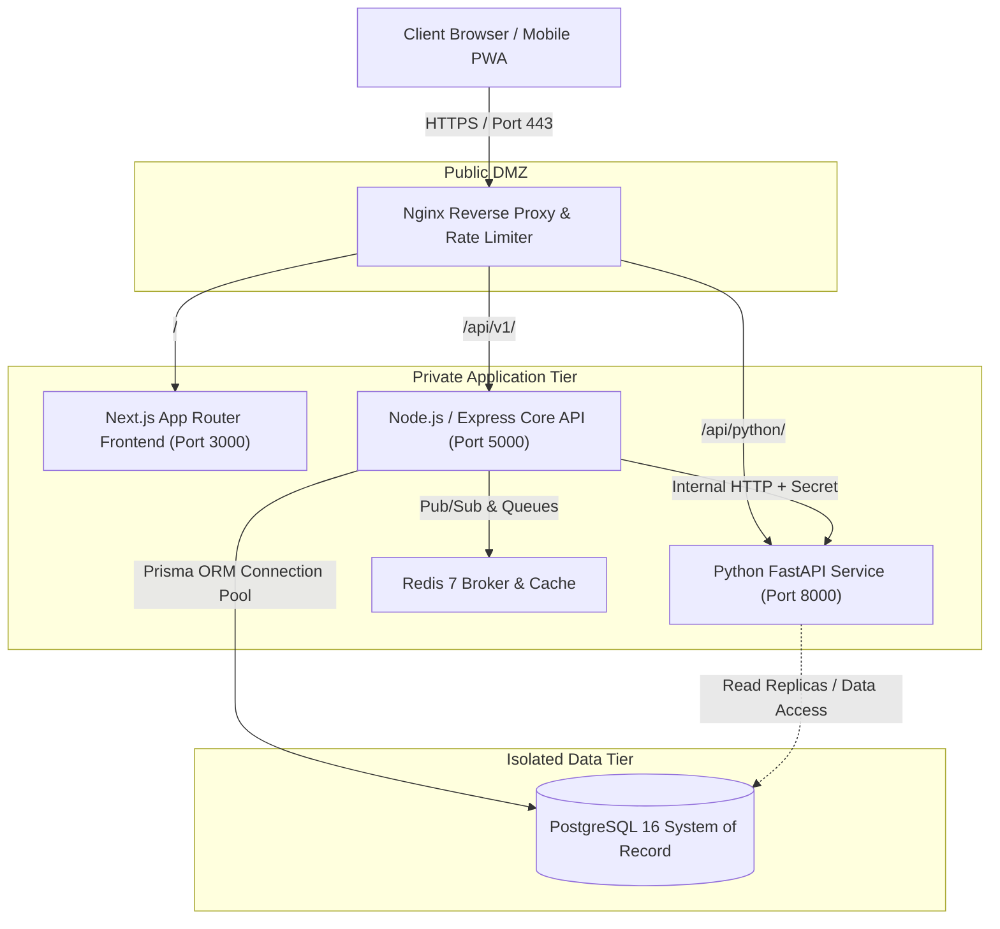

# PeopleCore HRMS — System Architecture & Technical Specifications

---

## 1. System Overview

PeopleCore is an enterprise workforce management, attendance, leave, and payroll platform built with a decoupled, modular microservices architecture:
- **Presentation Layer**: Next.js App Router (TypeScript, Tailwind CSS, TanStack Query patterns, React Hook Form)
- **Core Business API**: Node.js & Express (TypeScript, modular routers, JWT auth, RBAC middleware, field-level masking)
- **High-Precision Financial Engine**: Python 3.11 & FastAPI (`Decimal` arithmetic, `ROUND_HALF_UP` quantization, Pydantic validation)
- **System of Record**: PostgreSQL 16 (strict constraints, composite unique indexes, relational foreign keys, automated migrations)
- **Caching & Job Broker**: Redis 7
- **Reverse Proxy**: Nginx with SSL/TLS termination, rate limiting, and security headers

---

## 2. High-Level Architecture Diagram

---

## 3. Service Boundaries & Authoritative Ownership

| Service | Authoritative Entity Ownership | Responsibilities |
| :--- | :--- | :--- |
| **Node.js Express Core** | `User`, `Employee`, `Department`, `Shift`, `AttendanceRecord`, `LeaveRequest`, `PayrollPeriod`, `Payslip`, `Document`, `AuditLog` | Authentication, RBAC, CRUD, shift tracking, leave approvals, NACHA ACH file generation, vault storage. |
| **Python FastAPI Microservice** | None (Stateless Calculation & Intelligence) | High-precision Decimal payroll math, tax brackets, proration, rounding, workforce analytics synthesis, and attrition modeling. |
| **PostgreSQL** | Authoritative System of Record | Enforces ACID guarantees, uniqueness constraints (e.g. `@@unique([payrollPeriodId, employeeId])`), cascade rules. |
| **Redis** | Ephemeral State | Distributed rate limiting, session revocation, asynchronous background queues. |

---

## 4. Key Architectural Trade-Offs

1. **Decoupled Python Payroll Engine vs Single Monolithic Node Engine**:
   - *Decision*: Offload gross-to-net tax and deduction calculations to a specialized Python FastAPI service.
   - *Justification*: JavaScript's `Number` type is an IEEE-754 double-precision float subject to cumulative fractional cent drift (e.g. `0.1 + 0.2 = 0.30000000000000004`). Python's native `Decimal` module provides arbitrary-precision decimal arithmetic and statutory `ROUND_HALF_UP` financial quantization.
2. **PostgreSQL Relational DB vs Document NoSQL**:
   - *Decision*: PostgreSQL with Prisma ORM.
   - *Justification*: Financial ledgers, leave balance deductions, and reporting hierarchies require strict ACID transactions, relational foreign key constraints, and concurrency-safe locks.
