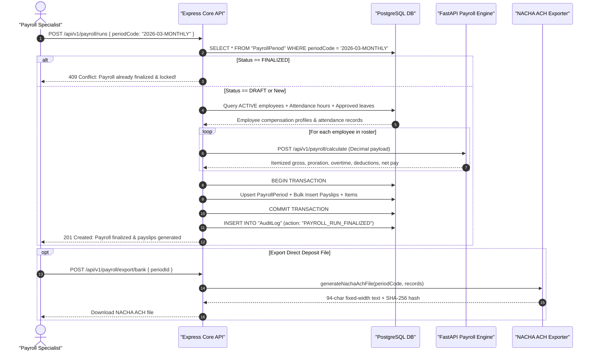
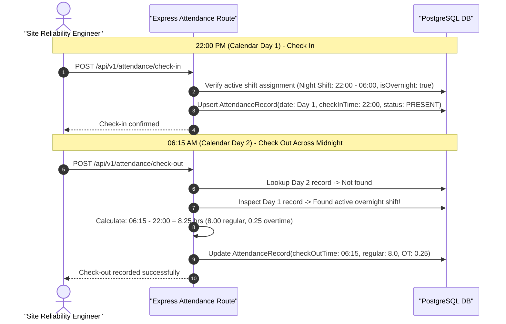
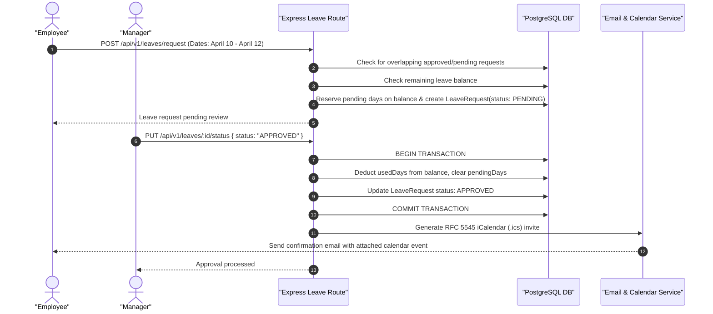

# PeopleCore HRMS — Service & Data Flow Sequences

---

## 1. Idempotent Payroll Preparation Sequence (Assessment 02, 05, 08, 15)

---

## 2. Attendance & Overnight Schedule Flow (Assessment 07)

---

## 3. Leave Request & Calendar Synchronization Flow (Assessment 07, 08)

