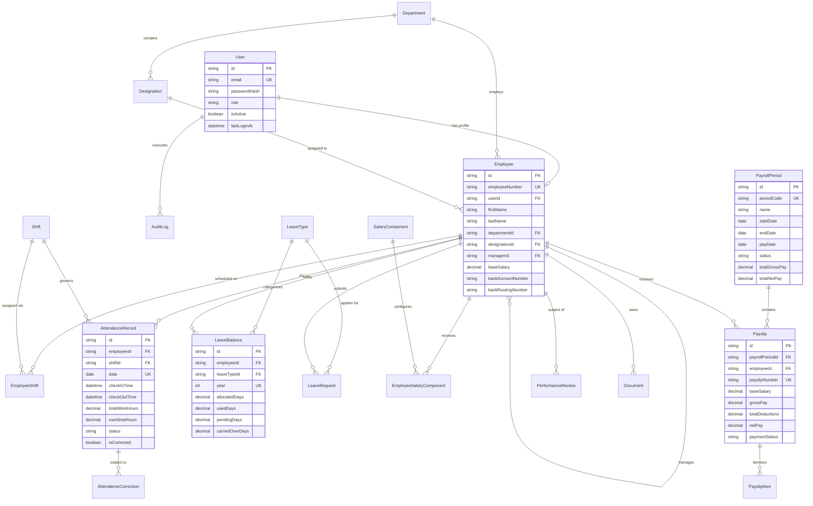

# PeopleCore HRMS — Database Entity-Relationship Diagram (ERD)
**Assessment 03 | Technical Skills Evaluation Cohort**

---

## 1. Complete Database Entity-Relationship Diagram



---

## 2. Critical Idempotency & Concurrency Constraints

1. **Payslip Idempotency**:
   ```sql
   CREATE UNIQUE INDEX "Payslip_payrollPeriodId_employeeId_key" 
   ON "Payslip"("payrollPeriodId", "employeeId");
   ```
   *Guarantees*: An employee can never have duplicate payslips generated for the same payroll period, preventing double disbursement.

2. **Daily Attendance Uniqueness**:
   ```sql
   CREATE UNIQUE INDEX "AttendanceRecord_employeeId_date_key" 
   ON "AttendanceRecord"("employeeId", "date");
   ```
   *Guarantees*: An employee cannot clock in twice on the same day without an explicit correction request.

3. **Annual Leave Entitlement Balance Uniqueness**:
   ```sql
   CREATE UNIQUE INDEX "LeaveBalance_employeeId_leaveTypeId_year_key" 
   ON "LeaveBalance"("employeeId", "leaveTypeId", "year");
   ```
   *Guarantees*: Exactly one balance ledger entry exists per leave category per employee per calendar year.
